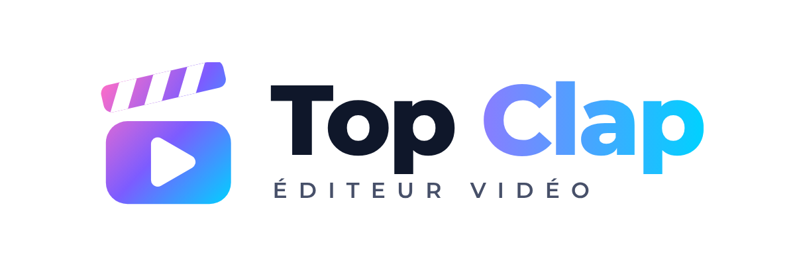

<p align="center">
  <picture>
    <source media="(prefers-color-scheme: dark)" srcset="brand/png/logo-horizontal.png">
    
  </picture>
</p>

<p align="center"><b>Créez · Montez · Partagez</b> — donnez vie à vos idées.</p>

# Top Clap

Éditeur vidéo **open source** dans le navigateur, inspiré de CapCut, DaVinci Resolve, Premiere Pro et After Effects, pensé pour créer automatiquement des vidéos **immobilières** pour YouTube, Instagram Reels, Facebook et TikTok.

- Fonctionne sur **téléphone, tablette et ordinateur**, sans installation ni compte.
- Vos photos et vidéos **ne quittent pas votre appareil**.
- Modèles d'IA **open source** dans le navigateur, et serveur IA optionnel pour les plus lourds (voir [MODELS.md](MODELS.md)).
- Licence **MIT**.

## Démarrer

```bash
git clone https://github.com/illynetwork-blip/Topclap.git
cd Topclap
python3 -m http.server 8080        # puis http://localhost:8080
```

Ou en ligne gratuitement : *Settings › Pages › Source : GitHub Actions* (dépôt public, ou plan GitHub payant pour un dépôt privé). Le workflow publie l'appli à chaque push sur `main`.

## Tout automatiser

**Assistant vidéo** (bouton en haut) : choisissez un objectif, renseignez le bien une fois, et l'appli génère tout.

| Objectif | Ce qui est généré |
|---|---|
| Annonce immobilière | Plans classés (extérieur d'accroche → intérieurs → extérieur de nuit), mouvements caméra, transitions, prix animé, atouts, écran de fin |
| Reel / Short / TikTok | 9:16, accroche en 1 s, plans démultipliés, coupes sur le rythme, sous-titres animés |
| Visite guidée | Plans longs, effet drone, voix off descriptive |
| Vidéo YouTube | 16:9, chapitres (marqueurs), écran de fin |
| Avant / Après | Volets animés : photo d'origine vs nuit / HDR / ciel |
| Face caméra | Silences coupés, sous-titres Whisper, musique avec ducking |

Ensuite : **export multi-format** en une fois (16:9, 9:16, 4:5, 1:1), **textes pour les réseaux** (titre, description avec chapitres, hashtags par plateforme), **miniature YouTube / couverture Reels**.

Outils automatiques à l'unité (onglet **Auto**) : montage express, coupes sur le rythme (détection du tempo), découpage en plans, suppression des silences, arrêt sur image, calque de réglage, passage au 9:16, marqueurs sur les temps, ducking, normalisation, voix claire, sous-titres automatiques ou depuis un texte, import `.srt` / `.vtt`.

## Fonctions de montage

**Timeline** : multipiste, piste principale magnétique, glisser entre pistes, rognage, aimantation, marqueurs (M), J / K / L, couper (S), annuler illimité, sauvegarde automatique.

**Animation (After Effects)** : images clés position / échelle / rotation / opacité avec lissage, animation directe dans l'aperçu, 13 animations de texte (lettre par lettre, machine à écrire, compteur de prix…), sous-titres mot à mot (karaoké, encadré, un mot à la fois, classique, élégant), formes et pictos immobiliers, barre de progression.

**Étalonnage (DaVinci)** : roues ombres / tons moyens / hautes lumières, 6 LUT intégrées + import `.cube`, 14 filtres, réglages fins, scopes (forme d'onde, parade RVB, histogramme, vecteurscope), masques (rectangle, ellipse, dégradé), incrustation fond vert, calque de réglage.

**Immobilier** : Jour → Nuit (fixe ou animé), ciel bleu, fenêtres allumées, golden hour, heure bleue, HDR, hiver, Photo 3D (parallaxe), Avant / Après, drone cinématique.

**24 transitions, 22 effets, 40 polices, 4 formats**, repères (zones sûres Reels / TikTok / Shorts, tiers).

**Audio** : musiques libres générées, import, voix off (micro ou IA), ducking, voix claire (EQ + compresseur), normalisation, fondus, forme d'onde.

**Export** : MP4 ou WebM jusqu'en 4K, plusieurs formats à la suite, PNG, projet `.json`, sous-titres `.srt`, finalisation MP4 −14 LUFS via le serveur.

## IA open source

| Dans le navigateur | Sur le serveur (`server/`) |
|---|---|
| Whisper (sous-titres), Depth Anything V2 (photo 3D), BiRefNet (détourage), Swin2SR (agrandissement), Piper (voix FR), Qwen3 0.6B (rédaction) | faster-whisper, Chatterbox (voix + clonage), Qwen-Image-Edit (nuit photoréaliste, home staging), Z-Image / FLUX.2 klein 4B, Wan 2.2 (photo → vidéo), ACE-Step (musique), Demucs, DeepFilterNet, Real-ESRGAN, rembg, Ollama, FFmpeg |

Détails, licences et modèles exclus : [MODELS.md](MODELS.md). Installation du serveur : [server/README.md](server/README.md).

## Développement

```
src/head.html, src/styles.css, src/body.html   interface
src/js/*.js                                     modules (ordre alphabétique)
build.py                                        assemble index.html (à commiter)
tests/smoke.mjs                                 tests navigateur
server/                                         serveur IA optionnel
```

```bash
python3 build.py                     # régénère index.html
npm i --no-save playwright && npx playwright install chromium && node tests/smoke.mjs
```

Charte graphique et logos : [brand/](brand/README.md). Sécurité : [SECURITY.md](SECURITY.md). Audit et limites connues : [AUDIT.md](AUDIT.md).

## Licence

[MIT](LICENSE). Les modèles d'IA gardent leur propre licence (voir [MODELS.md](MODELS.md)).
