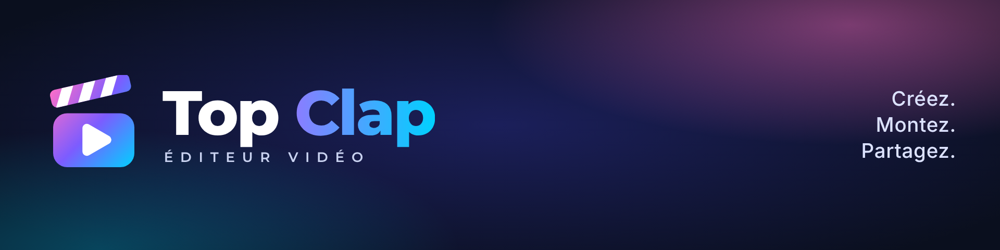

# Charte Top Clap

## Logo

Un clap de cinéma qui s'ouvre sur un bouton play : le nom raconté en une image. Corps en dégradé rose néon → violet → bleu électrique, claquette dégradée rayée de blanc, play blanc.

| Fichier | Usage |
|---|---|
| `logo-icon.svg` | Icône vectorielle |
| `logo-horizontal.svg` / `logo-horizontal-clair.svg` | Logo complet vectoriel, fond sombre / fond clair (police intégrée) |
| `png/logo-principal.png` | Format principal 1024 × 1024 |
| `png/logo-horizontal.png`, `png/logo-horizontal-clair.png` | 1200 × 420 (transparent / blanc) |
| `png/icone-app-1024.png`, `png/icone-512.png`, `png/icone-claire-512.png`, `png/icone-transparente-512.png` | Icônes d'application |
| `png/favicon-32/64/128/180/256.png` | Favicons (180 = icône Apple) |
| `png/profil-reseaux-1080.png` | Photo de profil Instagram, Facebook, YouTube, TikTok, X |
| `png/banniere-1920x480.png`, `png/banniere-site-728x90.png`, `png/reseaux-1200x628.png`, `png/youtube-banniere-2560x1440.png` | Bannières |
| `png/vignette-1080.png`, `png/ecran-accueil-1080x1920.png` | Vignette carrée, écran d'accueil mobile |

Régénérer : `python3 brand/make_brand.py && node brand/render.mjs` (Playwright requis).

## Couleurs

| Nom | Hex |
|---|---|
| Violet principal | `#6C5CE7` |
| Bleu électrique | `#00D1FF` |
| Rose néon | `#FF6EC7` |
| Vert cyan | `#00FFA3` |
| Bleu nuit | `#0F172A` |

Dégradé du logo : `#FF6EC7 → #7C5CFF → #00D1FF`. Dégradé du mot « Clap » : `#8B7CFF → #00D1FF`.

## Typographies

**Montserrat** (logo, titres) et **Inter** (interface), SIL Open Font License 1.1, intégrées à l'application.

## Signature

Créez · Montez · Partagez — *Donnez vie à vos idées.*
